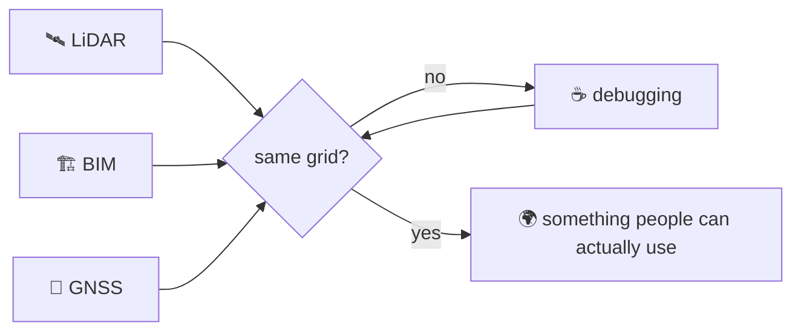

# Hi, Earth! 🌎

```json
{
  "type": "Feature",
  "properties": {
    "name": "Faizan Arif",
    "does": "makes computers understand where things are",
    "works_with": ["point clouds", "BIM models", "Gaussian splats", "GNSS", "live sensor feeds"],
    "currently_at": "Kodifly, building Digital Twins for infrastructure in Hong Kong",
    "favourite_question": "which coordinate system are you in?",
    "crs": "EPSG:2326 (please only apply it once)"
  },
  "geometry": {
    "type": "Point",
    "coordinates": "somewhere in Pakistan 🇵🇰"
  }
}
```

---

### 🐛 The bug that made me who I am

```diff
- BIM model position: 1,167 km away from the LiDAR scan 😅
- every transform looked correct on its own
- nothing crashed, nothing warned
+ cause: one HK1980 → ECEF conversion running twice
+ fix: one coordinate frame, one source of truth
+ lesson: spatial bugs don't crash, they just quietly move your building to another city
```

### 🧠 How my brain processes spatial data



### ⏳ Loading...

```
DGGS (H3, rHEALPix)        ▓▓░░░░░░░░  just started
grad school in GeoAI       ▓▓▓▓░░░░░░  applications loading
AI that reasons about space ▓░░░░░░░░░  thinking about it a lot
```

### 💬 Ping me about

`point clouds` `Three.js` `Cesium` `Gaussian splats` `coordinate system pain` `puzzles 🧩`

### 🧰 Usual suspects

[](https://skillicons.dev)

### 😄 Fun fact

I love solving puzzles, not just on the screen but in real life too.

---

📫 [Email](mailto:faizanarif1245@gmail.com) · [LinkedIn](https://linkedin.com/in/imfaizanarif)
